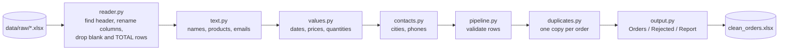

# Excel Data Cleaner

A Python tool that merges messy Excel exports from several sources into one clean, analysis-ready workbook. It doesn't silently delete anything: every fix is counted, every rejected row is listed with the reason and its exact location in the original file, and the original files are never modified.

**[▶ Try it in the browser](https://excel-data-cleaner.streamlit.app)**: run it on the sample files or upload your own, then download the cleaned workbook. No installation needed.

```
$ python -m cleaner data/raw
Read 547 rows from data/raw
  517 clean orders
  30 rejected rows (see the Rejected sheet)
Saved output/clean_orders.xlsx
```

## The scenario

*This is a case study built on generated sample data, which is included in `data/raw/`.*

A small electronics retailer sells through two stores and an online shop. Each channel exports its orders to Excel in its own way, and the owner needs a single table of all orders for reporting. Merging them by hand takes hours, and has to be repeated every month.

The three exports disagree on almost everything:

| Problem | Example |
|---|---|
| Different column names | `Order ID` / `order_id` / `ID`, `City` / `city` / `Location` |
| Header not in the first row | the online report starts with a title, a date and a blank line |
| Three date formats | real Excel dates, `24.03.2026` (day first), `2/5/2026` (month first) |
| Numbers stored as text | `$1,249.00`, `199.99 USD`, `2 pcs` |
| Inconsistent spelling | 7 products written 35 ways, 5 cities written 20 ways (`NYC`, `L.A.`, `Chicago, IL`) |
| Messy contact details | 6 phone formats, 41 invalid emails, extra spaces, UPPER and lower case |
| Rows that are not orders | blank rows in the middle, a `TOTAL` row at the bottom |
| Duplicates | identical rows, and orders re-exported by the online shop in a different format |
| Impossible values | quantities of `0` and `-1`, missing prices |

The full list, with counts and assumptions, is in [docs/data_issues.md](docs/data_issues.md).

## Before and after

**Before** (`store_south.xlsx`, as exported):

| order_id | date | customer_name | phone_number | city | product | quantity | price |
|---|---|---|---|---|---|---|---|
| S-2002 | 26.02.2026 | Linda Martinez | 555-301-0310 | NY | Noise Cancelling Headphones | 1 pcs | 199.99 USD |
| S-2008 | 03.03.2026 | Nancy Brown | +1 555 734 6706 | Houston TX | Noise Cancelling Headphones | 5 pcs | $199.99 |
| S-2023 | 13.01.2026 | Matthew Johnson | 1-555-183-8425 | LA | Wireless&nbsp;&nbsp;Mouse | 1 pcs | 24.99 |

**After** (`Orders` sheet):

| order_id | order_date | customer | phone | city | product | quantity | unit_price | line_total |
|---|---|---|---|---|---|---|---|---|
| S-2002 | 2026-02-26 | Linda Martinez | +15553010310 | New York | Noise Cancelling Headphones | 1 | $199.99 | $199.99 |
| S-2008 | 2026-03-03 | Nancy Brown | +15557346706 | Houston | Noise Cancelling Headphones | 5 | $199.99 | $999.95 |
| S-2023 | 2026-01-13 | Matthew Johnson | +15551838425 | Los Angeles | Wireless Mouse | 1 | $24.99 | $24.99 |

## The output

One workbook, `output/clean_orders.xlsx`, with three sheets:

| Sheet | Contents |
|---|---|
| **Orders** | Clean orders from all sources with standard columns, real dates and numbers, a `line_total` column and an `issues` column for non-critical problems (e.g. an invalid email that was removed) |
| **Rejected** | Every row that was not used, with its **original values**, the **source file and Excel row number**, and the **reason**: `quantity must be positive (-1)`, `missing price`, `duplicate of order N-1049 (kept store_north.xlsx row 50)` |
| **Report** | What was changed, in plain English: names fixed, prices converted from text, duplicates removed, and the total revenue of clean orders |

The sheets are ready to use: styled and frozen header, filters on every column, date and currency formats, and column widths that fit the content.

## The web app

The same cleaner runs as a small [Streamlit](https://streamlit.io) app (`app.py`):

1. Use the three sample exports (each one can be downloaded, to see how messy it is) or upload your own `.xlsx` files.
2. Choose how dates are written in each file. A date like `2/5/2026` means a different day in the US and in Europe, so the app asks instead of guessing.
3. Click **Clean data** to see the row counts, browse the Orders, Rejected and Report tables and the raw data as it was read, and download `clean_orders.xlsx`.

Uploaded files are processed in a temporary folder and are not stored.

## Results on the sample data

| | |
|---|---|
| Rows read from 3 files | 547 |
| Clean orders | 517 |
| Rejected rows | 30 (17 duplicates, 13 invalid) |
| Clean orders with a note | 70 |
| Customer names fixed | 197 |
| Product names matched to the catalogue | 199 |
| Prices converted from text | 143 |
| City names standardized | 414 |
| Phone numbers standardized | 547 |
| Invalid emails removed | 41 |

## How it works



Each step is a separate module with small, testable functions. Every step returns a cleaned **copy** of the data plus a dictionary of counts, so the final report is built from what each step actually did.

## Key design decisions

- **Never guess when the data is ambiguous.** `2/5/2026` is 5 February in the US export and 2 May in a European one. The date format is configured per source, and a file with no configured format stops the run with a clear error. Reading the online export with the wrong format doesn't fail loudly: 130 dates become unreadable and 78 are read without any error, but as the wrong day.
- **Flag, don't delete.** Rows that can't be used for sales reporting go to the Rejected sheet with a reason and their exact location. Problems that don't affect the sale (an invalid email, a missing city) keep the order and add a note in the `issues` column.
- **Catalogues instead of clever matching.** Products and cities are matched against an explicit list of known names and spellings. An unknown value is reported, not "corrected" to the closest match.
- **Duplicates are resolved by rules, not by luck.** Copies of an order are matched by Order ID after cleaning. The most complete copy is kept, then the copy from the source that created the order. If two copies disagree on the date, product, quantity or price, none of them is kept, because there is no way to know which is right.
- **Original values in the Rejected sheet.** The client sees exactly what was in their file, so they can fix it at the source.
- **Raw data is never modified.** Cleaning works on copies, and the input files are only read.

## Pitfalls handled on purpose

Some of the most dangerous bugs in data cleaning give wrong results without any error. The code avoids these deliberately:

| Pitfall | What would go wrong | How it's handled |
|---|---|---|
| `pd.read_excel` guesses types | `2` and `"2 pcs"` in one column, quantities turn into `2.0` | read everything as `dtype=object`, convert later |
| The first row is assumed to be the header | every online-shop column becomes `Unnamed: N` | the header row is found by matching known column names |
| `NaN != NaN` is `True` | every empty cell is counted as "changed" | empty values are normalized to `None` before comparing |
| `groupby` drops missing keys | rows without an order ID silently disappear | they are kept before grouping |
| `str(5551234567.0)` is `"5551234567.0"` | a phone number gains an extra digit | whole-number floats become `int` first |
| `datetime` is also a `date` | dates come back with a time part | `datetime` is checked before `date` |

## Assumptions and limitations

- `NY` is read as New York City and `LA` as Los Angeles. With a real client, ambiguous abbreviations would be confirmed first.
- Customer names are converted to title case, so names with special capitalization (`McDonald`, `van der Berg`) may need a manual check.
- Phone numbers are expected to be US numbers and are stored in E.164 format (`+15551234567`).
- Emails are checked for a valid format, not for whether the address exists.

## Getting started

Requires Python 3.11+.

```bash
git clone https://github.com/Bab1cc/excel-data-cleaner.git
cd excel-data-cleaner
pip install -r requirements.txt
```

Generate the sample data (already included in the repository) and run the cleaner:

```bash
python scripts/make_messy_data.py
python -m cleaner data/raw
python -m cleaner data/raw -o reports/march.xlsx    # custom output path
```

Start the web app locally (it opens in your browser):

```bash
streamlit run app.py
```

Run the tests:

```bash
python -m pytest
```

## Testing

Around 150 `pytest` tests cover every module: header detection, each cleaning rule (including edge cases like `31.02.2026`, `5551234567.0` or `Chicago, IL`), duplicate resolution, the content and formatting of the output workbook, and the command line. Tests build small Excel files in temporary folders, so they never depend on the sample data.

## Project structure

```
├── app.py               # Streamlit web app
├── cleaner/
│   ├── reader.py        # reads all files into one table with standard columns
│   ├── text.py          # customer names, products, emails
│   ├── values.py        # dates, prices, quantities
│   ├── contacts.py      # cities, phone numbers
│   ├── pipeline.py      # runs all steps, separates rejected rows
│   ├── duplicates.py    # keeps one copy of every order
│   ├── output.py        # writes the formatted Excel workbook
│   └── __main__.py      # command line entry point
├── scripts/
│   ├── make_messy_data.py   # generates the sample exports
│   └── explorer.py          # profiles the raw files
├── data/raw/            # sample input files
├── docs/
│   ├── data_issues.md       # every problem found in the data, with counts
│   └── technical-guide.md   # module-by-module documentation (in Serbian)
└── tests/               # pytest test suite
```

## Technical documentation

A detailed, module-by-module guide (every function, the duplicate algorithm step by step, and how to extend the project with a new source file, product or rule) is in [docs/technical-guide.md](docs/technical-guide.md), currently in Serbian.

## Roadmap

- Optional export of the clean orders to a PostgreSQL database