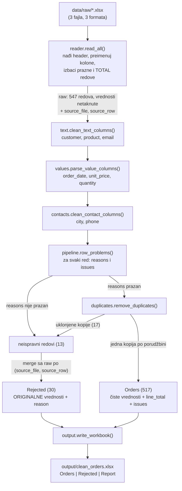
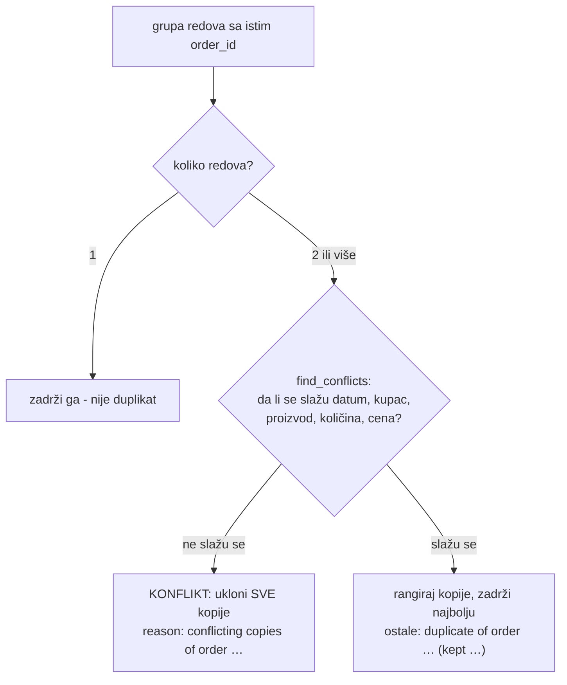

# Excel Data Cleaner: tehnički vodič

> Kratak pregled projekta je u [README.md](../README.md). Ovaj vodič objašnjava **kako** i **zašto** radi svaki deo koda.

Alat koji uzima **prljave Excel izvoze porudžbina** iz tri prodajna kanala (dve prodavnice i online shop), čisti ih, spaja u jednu tabelu, uklanja duplikate i pravi **jedan uredan Excel fajl** koji klijent može odmah da koristi: čiste porudžbine, spisak odbačenih redova sa razlogom i izveštaj o tome šta je urađeno.

```
data/raw/store_north.xlsx  ┐
data/raw/store_south.xlsx  ├──►  python -m cleaner  ──►  output/clean_orders.xlsx
data/raw/online_shop.xlsx  ┘                             ├─ Orders    (517 čistih porudžbina)
                                                         ├─ Rejected  (30 odbačenih redova + razlog)
                                                         └─ Report    (šta je promenjeno + ukupan prihod)
```

Osnovna ideja: **ništa se ne briše i ne menja tiho.** Svaki odbačen red se vidi u `Rejected` sa tačnim mestom u originalnom fajlu i razlogom. Svaka ispravka se broji u `Report`, a svaki problem koji ne ruši porudžbinu (npr. neispravan email) upisuje se u kolonu `issues`.

---

## Sadržaj

1. [Brzi start](#1-brzi-start)
2. [Struktura projekta](#2-struktura-projekta)
3. [Arhitektura](#3-arhitektura)
4. [Ulazni podaci i njihovi problemi](#4-ulazni-podaci-i-njihovi-problemi)
5. [Moduli i funkcije, detaljno](#5-moduli-i-funkcije-detaljno)
   - [reader.py: čitanje i standardne kolone](#51-cleanerreaderpy-čitanje-i-standardne-kolone)
   - [text.py: imena, proizvodi, emailovi](#52-cleanertextpy-imena-proizvodi-emailovi)
   - [values.py: datumi, cene, količine](#53-cleanervaluespy-datumi-cene-količine)
   - [contacts.py: gradovi i telefoni](#54-cleanercontactspy-gradovi-i-telefoni)
   - [pipeline.py: spajanje koraka i odbacivanje](#55-cleanerpipelinepy-spajanje-koraka-i-odbacivanje)
   - [duplicates.py: uklanjanje duplikata](#56-cleanerduplicatespy-uklanjanje-duplikata)
   - [output.py: formatiran Excel](#57-cleaneroutputpy-formatiran-excel)
   - [\_\_main\_\_.py: komandna linija](#58-cleaner__main__py-komandna-linija)
   - [scripts/: generator i explorer](#59-scripts-generator-i-explorer)
6. [Duplikati: kako i zašto, do detalja](#6-duplikati-kako-i-zašto-do-detalja)
7. [Rezultat na pravim podacima](#7-rezultat-na-pravim-podacima)
8. [Zamke u pandas-u koje kod izbegava](#8-zamke-u-pandas-u-koje-kod-izbegava)
9. [Testovi](#9-testovi)
10. [Kako proširiti projekat](#10-kako-proširiti-projekat)
11. [Pretpostavke i poznata ograničenja](#11-pretpostavke-i-poznata-ograničenja)

---

## 1. Brzi start

Sve komande se pokreću iz korena projekta (folder u kome je `README.md`), jer su putanje `data/raw` i `output/` relativne.

```powershell
pip install -r requirements.txt
```

```powershell
python -m cleaner
```

Izlaz:

```
Read 547 rows from data\raw
  517 clean orders
  30 rejected rows (see the Rejected sheet)
Saved output\clean_orders.xlsx
```

Drugi ulazni folder i druga izlazna putanja (vidi [5.8](#58-cleaner__main__py-komandna-linija)):

```powershell
python -m cleaner data/raw -o reports/march.xlsx
```

Testovi:

```powershell
python -m pytest -q
```

Svaki modul može da se pokrene i sam, da se vidi šta tačno taj korak radi na pravim podacima:

| Komanda | Šta ispisuje |
|---|---|
| `python -m cleaner --help` | opis programa, argumente i podrazumevane putanje |
| `python -m cleaner.reader` | oblik spojene tabele `(547, 11)` i broj redova po fajlu |
| `python -m cleaner.text` | koliko je imena, proizvoda i emailova promenjeno ili odbačeno |
| `python -m cleaner.values` | koliko je cena i količina pretvoreno iz teksta, i opseg datuma |
| `python -m cleaner.contacts` | koliko je gradova i telefona standardizovano, i raspodelu gradova |
| `python -m cleaner.pipeline` | ceo izveštaj i spisak svih odbačenih redova sa razlogom |
| `python -m cleaner.output` | pravi `output/clean_orders.xlsx` (isto kao `python -m cleaner`, samo kraći ispis) |

Testirano sa Python 3.15, pandas 3.1, openpyxl 3.1, pytest 9.2.

> `-m cleaner.reader` (a ne `python cleaner/reader.py`) je bitno: tako Python vidi `cleaner` kao paket, pa rade importi tipa `from cleaner.text import ...`.

---

## 2. Struktura projekta

```
excel-data-cleaner/
├── cleaner/                  # sav kod za čišćenje (Python paket)
│   ├── __init__.py           # prazan, samo označava da je cleaner paket
│   ├── reader.py             # 1. čita sve .xlsx fajlove u jednu tabelu sa standardnim kolonama
│   ├── text.py               # 2. imena kupaca, nazivi proizvoda, emailovi
│   ├── values.py             # 3. datumi, cene, količine (tekst -> pravi tipovi)
│   ├── contacts.py           # 4. gradovi i brojevi telefona
│   ├── duplicates.py         # 5. pronalazi i uklanja duplikate porudžbina
│   ├── pipeline.py           # spaja korake 2–5, deli redove na čiste i odbačene
│   ├── output.py             # 6. upisuje rezultat u formatiran Excel
│   └── __main__.py           # komandna linija: python -m cleaner [folder] [-o fajl.xlsx]
├── tests/                    # pytest testovi, po jedan fajl za svaki modul
│   ├── test_reader.py
│   ├── test_text.py
│   ├── test_values.py
│   ├── test_contacts.py
│   ├── test_duplicates.py
│   ├── test_pipeline.py
│   ├── test_output.py
│   └── test_cli.py
├── data/raw/                 # ulaz: originalni (prljavi) izvozi, nikad se ne menjaju
│   ├── store_north.xlsx
│   ├── store_south.xlsx
│   └── online_shop.xlsx
├── output/                   # izlaz: clean_orders.xlsx (u .gitignore, pravi se ponovo komandom)
├── docs/
│   ├── data_issues.md        # spisak svih problema pronađenih u podacima + pretpostavke
│   ├── explorer_output.txt   # sačuvan ispis scripts/explorer.py
│   └── technical-guide.md    # ovaj vodič
├── scripts/
│   ├── make_messy_data.py    # generiše lažne prljave podatke u data/raw/
│   └── explorer.py           # brzi profil svakog sirovog fajla (kolone, prazna polja, top vrednosti)
├── README.md                 # kratak pregled projekta (na engleskom)
├── requirements.txt          # pandas, openpyxl, pytest
└── .gitignore
```

**Zašto je kod podeljen baš ovako:** svaki modul rešava jednu vrstu problema i ne zna ništa o ostalima, osim par malih pomoćnih funkcija (`clean_whitespace`, `_as_object`) koje se uvoze iz `text.py`. Zato svaki modul može da se testira i pokrene sam, a greška u jednom koraku se lako lokalizuje.

---

## 3. Arhitektura

### 3.1 Tok podataka



### 3.2 Pravila koja važe u celom projektu

Ovo su odluke koje se ponavljaju u svakom modulu. Kad se razumeju, ceo kod postaje predvidiv.

**1. Svaki korak vraća `(df, report)` i nikad ne menja ulaz.**
Svaka funkcija koja radi nad tabelom prvo radi `df.copy()`, menja kopiju i vraća je zajedno sa rečnikom brojeva (`{"email_invalid": 41, ...}`). Pipeline te rečnike spaja sa `report.update(...)`. Original ostaje netaknut, što ima dve koristi: (a) `pipeline` i dalje ima **originalne vrednosti** u `raw` da ih pokaže u `Rejected` sheet-u i u porukama tipa `invalid quantity (two)`; (b) funkcija bez sporednih efekata je lako testirati. Za svaki korak postoji test `test_original_is_not_modified`.

**2. Funkcije za jednu ćeliju vraćaju vrednost ili `None`, ali nikad ne brišu redove.**
`clean_email("bob@example")` vraća `None`, a ne baca grešku i ne briše red. Odluku šta da se radi sa `None` donosi **samo** `pipeline.row_problems`. Tako je pravilo "šta se odbacuje" na jednom mestu, a ne razbacano po pet fajlova.

**3. Jedan oblik za "nema vrednosti": `None`.**
Excel i pandas za praznu ćeliju daju `None`, `NaN`, `""` ili `"   "`. Sve se to svodi na `None` (`clean_whitespace` vraća `None` za prazan tekst, a `_as_object` pretvara `NaN` u `None`). Inače `NaN is None` je `False` i `NaN != NaN` je `True`, pa bi provere i brojanja bili pogrešni (vidi [poglavlje 8](#8-zamke-u-pandas-u-koje-kod-izbegava)).

**4. Svaki red zna odakle je došao: `source_file` + `source_row`.**
Reader dodaje ime fajla i **broj reda u Excel-u** (onaj koji klijent vidi levo u Excel-u). Taj par je jedinstvena "adresa" reda. Koristi se u porukama (`kept store_north.xlsx row 75`), u `Rejected` sheet-u i za spajanje uklonjenih duplikata sa originalnim redovima.

**5. Nepoznato je greška ili `None`, nikad pogađanje.**
Nepoznata kolona → `ValueError`. Fajl bez poznatog formata datuma → `ValueError`. Nepoznat proizvod ili grad → `None` i to se prijavi. Pogađanje bi dalo podatke koji *izgledaju* čisto, a pogrešni su, što je gore od podataka koji su očigledno prljavi.

**6. `reasons` (odbaci red) vs. `issues` (zadrži red, zabeleži problem).**
- **reasons:** porudžbina je neupotrebljiva za izveštaj o prodaji: nema ID, datum, proizvod, ispravnu količinu ili cenu. Red ide u `Rejected`.
- **issues:** problem je samo u kontakt podacima (ime, email, telefon, grad). Prodaja se desila i treba je računati, pa red ostaje u `Orders`, a problem se upisuje u kolonu `issues`.

**7. Čitanje je odvojeno od čišćenja.**
`reader` samo pronalazi podatke i daje im standardna imena, a vrednosti ostavlja **tačno kakve su u Excel-u** (`dtype=object`). Tek kad sva tri fajla imaju isti oblik, ostali moduli ih čiste, svaki samo svoje kolone.

### 3.3 Zavisnosti između modula

```
reader.py      ← ne zavisi ni od čega iz projekta
text.py        ← ne zavisi ni od čega (definiše clean_whitespace i _as_object)
values.py      ← text (clean_whitespace, _as_object)
contacts.py    ← text (clean_whitespace, _as_object)
duplicates.py  ← ne zavisi ni od čega
pipeline.py    ← reader, text, values, contacts, duplicates
output.py      ← (pipeline samo u if __name__ == "__main__" bloku)
__main__.py    ← reader (RAW_DIR), pipeline (run), output (write_workbook)
```

---

## 4. Ulazni podaci i njihovi problemi

Tri fajla su izvozi iz tri sistema iste firme. Svaki ima svoja imena kolona, svoj format datuma i svoje greške. Detaljan spisak sa tačnim brojevima je u [docs/data_issues.md](data_issues.md), a ukratko:

| Fajl | Redova | Glavni problemi |
|---|---|---|
| `store_north.xlsx` | 185 | 5 potpuno istih duplikata; prava Excel datumska polja; prazna imena i emailovi |
| `store_south.xlsx` | 150 | cene kao tekst u 3 oblika (`$39.00`, `39.00`, `39.00 USD`); 7 bez cene; količine kao `2 pcs`; 6 nemogućih količina (`0`, `-1`); prazni redovi u sredini; datumi `24.03.2026` |
| `online_shop.xlsx` | 212 | 3 reda naslova iznad headera; `TOTAL` red na dnu; datumi `2/5/2026` (mesec/dan); 12 porudžbina koje su već izvezene iz store_north, ali drugačije zapisane |
| **sva tri** | **547** | različita imena kolona; mešana velika i mala slova i višak razmaka; 35 varijanti za 7 proizvoda; 20 za 5 gradova; 6 formata telefona; 41 neispravan email |

Podaci su **potpuno lažni** i napravljeni su skriptom [scripts/make_messy_data.py](../scripts/make_messy_data.py) (fiksni `SEED = 42`, pa su uvek isti).

---

## 5. Moduli i funkcije, detaljno

### 5.1 `cleaner/reader.py`: čitanje i standardne kolone

**Zadatak:** iz svakog fajla pronaći pravu tabelu, dati kolonama ista imena i izbaciti redove koji nisu porudžbine. Vrednosti se **ne** menjaju.

#### Konstante

| Ime | Šta je | Zašto |
|---|---|---|
| `RAW_DIR` | `Path("data/raw")` | podrazumevani folder sa ulazom |
| `STANDARD_COLUMNS` | 9 imena: `order_id, order_date, customer, email, phone, city, product, quantity, unit_price` | jedan oblik tabele za sve fajlove, u fiksnom redosledu |
| `COLUMN_ALIASES` | rečnik `"normalizovano ime iz fajla" → standardno ime`, npr. `"email address" → "email"`, `"price (usd)" → "unit_price"` | rešava problem 9: isto polje se u svakom fajlu zove drugačije |
| `MIN_HEADER_MATCHES` | `5` | koliko poznatih imena kolona red mora imati da bi bio header |
| `SUMMARY_LABELS` | `{"total", "subtotal", "grand total"}` | vrednosti u koloni ID koje označavaju zbirni red |

#### `normalize_header(name)`

Pravi ključ za poređenje imena kolona: `"  Order   ID "` → `"order id"`, `"E-MAIL"` → `"e-mail"`, prazna ćelija → `""`.

```python
if pd.isna(name):
    return ""
return " ".join(str(name).split()).lower()
```

- `pd.isna` hvata i `None` i `NaN`, jer pandas praznu ćeliju daje u oba oblika.
- `str(name).split()` bez argumenta seče po **bilo kom** belom prostoru (razmaci, tabovi, novi redovi) i sam odbacuje razmake na krajevima, pa `" ".join(...)` u jednom koraku daje tekst bez viška razmaka. Nije potreban regex.
- `str()` je tu jer header može biti i broj.
- `.lower()` jer `Order ID`, `ORDER ID` i `order id` znače isto.

#### `find_header_row(raw)`

Vraća indeks reda u kome je header. `raw` je sheet pročitan sa `header=None`, dakle bez ikakvih pretpostavki.

```python
for i in range(len(raw)):
    matches = sum(normalize_header(cell) in COLUMN_ALIASES for cell in raw.iloc[i])
    if matches >= MIN_HEADER_MATCHES:
        return i
raise ValueError("No header row found: ...")
```

- Rešava problem 6: u `online_shop.xlsx` header je tek u 4. redu Excel-a, ispod naslova, datuma i praznog reda. Kad bi pandas sam uzeo prvi red kao header, sve kolone bi se zvale `Unnamed: N`.
- **Zašto baš 5 od 9:** to je više od pola. Red naslova ("Online shop - orders report") ili red sa podacima nikad nema 5 ćelija koje su imena kolona, pa ne može slučajno da prođe. A fajl u kome je **jedna** kolona preimenovana (npr. `discount` umesto `price`) i dalje ima 8 pogodaka, pa se header pronađe, a `read_orders` posle prijavi tačno koja kolona ne valja. Sa pravilom "svih 9" greška bi bila nejasna: "nema headera".

#### `read_orders(path)`

Čita jedan fajl i vraća njegove porudžbine sa standardnim imenima kolona, plus `source_file` i `source_row`.

1. **`pd.read_excel(path, header=None, dtype=object)`**
   - `header=None`: header tražimo sami (vidi gore).
   - `dtype=object`: pandas ne sme da pogađa tipove. Bez toga bi kolona sa `2`, `"2 pcs"` i praznim redom postala čudna mešavina, a `Qty` iz online_shop-a bi postao `2.0` (problem 13). Ovako `"2 pcs"`, `"$39.00"` i `"24.03.2026"` ostaju tačno kao u Excel-u, a pravi Excel datumi ostaju `datetime`.
2. **Nađi header:** `find_header_row(raw)`.
3. **Prevedi imena kolona** preko `COLUMN_ALIASES`, uz tri provere koje bacaju `ValueError` sa imenom fajla:
   - **nepoznata kolona** (npr. `discount`): bolje je stati nego tiho izgubiti kolonu ili je pogrešno protumačiti;
   - **dve kolone mapirane na isto ime** (npr. i `Price` i `Unit Price`): ne znamo koju da uzmemo;
   - **kolona koja nedostaje:** inače bi cela kolona bila tiho prazna.
   - Ćelije sa praznim headerom se preskaču.
4. **Uzmi redove ispod headera** i preimenuj kolone.
5. **Dodaj `source_file` i `source_row` pre brisanja redova.** Kad bi se dodavalo posle, brojevi bi se pomerili i ne bi odgovarali Excel-u. Kod `header=None` indeks 0 je prvi red Excel-a, pa je `source_row = indeks + 1`.
6. **Izbaci prazne i zbirne redove** (problemi 5 i 7):
   - prazan = **sve** ćelije su `NaN` ili sami razmaci (`_is_blank`);
   - zbirni = `order_id` je `TOTAL` / `subtotal` / `grand total`.
   - Red kome fali **samo** ID se **ne** briše: to je verovatno prava porudžbina sa greškom, a pipeline će je prijaviti kao `missing order ID`.
7. Vrati kolone u fiksnom redosledu i resetuj indeks na `0..n-1`.

#### `read_all(folder)`

```python
if not folder.is_dir():
    raise FileNotFoundError(f"Folder not found: {folder}")
paths = sorted(p for p in folder.glob("*.xlsx") if not p.name.startswith("~$"))
if not paths:
    raise ValueError(f"No .xlsx files found in {folder}")
return pd.concat([read_orders(p) for p in paths], ignore_index=True)
```

- **Folder koji ne postoji i prazan folder su dve različite greške**, pa dobijaju različite poruke: greška u kucanju imena (`Folder not found: data/rwa`) i folder bez fajlova (`No .xlsx files found in ...`). Bez prve provere `glob` nad nepostojećim folderom tiho vraća praznu listu, pa bi korisnik dobio zbunjujuću poruku "nema fajlova". `FileNotFoundError` je Python-ov standardni izuzetak za putanju koja ne postoji, a `is_dir()` (a ne `exists()`) hvata i slučaj kada se greškom prosledi putanja do fajla umesto do foldera.
- `sorted` daje uvek isti redosled fajlova, pa i isti rezultat na svakom pokretanju.
- `~$ime.xlsx` su privremeni fajlovi koje Excel pravi dok je fajl otvoren. Bez ovog filtera `read_all` bi pukao čim neko otvori ulazni fajl.
- `ignore_index=True` daje jedinstven indeks `0..546` za celu tabelu, što je potrebno kasnije kada se redovi biraju po indeksu.

#### `_is_blank(value)`

`True` za `None`, `NaN` i tekst od samih razmaka. Koristi se za prepoznavanje praznih redova.

---

### 5.2 `cleaner/text.py`: imena, proizvodi, emailovi

**Zadatak:** očistiti kolone `customer`, `product` i `email` (problemi 11 i 12).

#### Konstante

| Ime | Šta je |
|---|---|
| `PRODUCTS` | katalog klijenta: 7 jedinih ispravnih naziva proizvoda |
| `EMAIL_PATTERN` | regex: slova/cifre/`._%+-`, pa `@`, pa domen, pa završetak od 2+ slova |
| `_PRODUCT_KEYS` | `{"usb-c hub": "USB-C Hub", ...}`, napravljen **iz** `PRODUCTS` |

#### `clean_whitespace(value)`

`"  John   Smith "` → `"John Smith"`; `""`, `"   "`, `None`, `NaN` → `None`; `123` → `"123"`.

```python
if pd.isna(value):
    return None
text = " ".join(str(value).split())
return text or None
```

Isti trik kao `normalize_header`, ali **bez** `.lower()`, jer ovde čuvamo originalna slova. `return text or None`: prazan string je u Pythonu "netačan", pa se `""` (i `"   "`, koji posle `split()` postaje `""`) pretvara u `None`. Ovo je osnovna funkcija za ceo projekat: svi ostali moduli je koriste da provere "da li je ćelija imala vrednost".

#### `clean_name(value)`

`"  JOHN   smith "` → `"John Smith"`.

```python
text = clean_whitespace(value)
return text.title() if text else None
```

Prvo razmaci, pa `.title()` (svaka reč velikim početnim slovom). Provera `if text` je tu jer bi `None.title()` pukao.

#### `match_product(value)`

`"usb-c  HUB"` → `"USB-C Hub"`; `"Gaming Chair"` → `None`.

```python
_PRODUCT_KEYS = {" ".join(name.split()).lower(): name for name in PRODUCTS}   # jednom, na nivou modula

def match_product(value):
    text = clean_whitespace(value)
    if text is None:
        return None
    return _PRODUCT_KEYS.get(text.lower())
```

- **Zašto rečnik, a ne `.title()`:** `"USB-C Hub".title()` daje `"Usb-C Hub"`, a `"27-inch Monitor".title()` daje `"27-Inch Monitor"`. Jedini pouzdan izvor tačnog naziva je katalog.
- **Zašto rečnik pravimo iz `PRODUCTS`, a ne ručno:** kad se doda nov proizvod, menja se samo lista, a ključ se pravi sam, uvek po istom pravilu kao ključ iz podataka.
- **Zašto van funkcije:** pravi se jednom pri importu, a ne 547 puta (za svaki red).
- `.get()` sam vraća `None` za nepoznat proizvod. Nepoznat proizvod se **ne pogađa**, nego se prijavljuje i porudžbina se odbacuje.

Rezultat: 35 varijanti zapisa → tačno 7 naziva iz kataloga, 0 nepoznatih.

#### `clean_email(value)`

`"  ANA@Example.COM "` → `"ana@example.com"`; `"bob@example"`, `"ana smith@x.com"`, `"anaexample.com"` → `None`.

```python
text = clean_whitespace(value)
if text is None:
    return None
text = text.lower()
return text if EMAIL_PATTERN.match(text) else None
```

- Mala slova idu **pre** provere jer regex dozvoljava samo `[a-z]`, inače bi ispravan `ANA@Example.COM` bio odbijen.
- `clean_whitespace` ne briše razmak **unutar** teksta, pa `"ana smith@example.com"` ostaje sa razmakom i regex ga odbija, kako treba.

#### `clean_text_columns(df)` → `(cleaned, report)`

Primenjuje tri funkcije na tri kolone i broji šta se desilo.

```python
for col, clean, bad_key in [("customer", clean_name, None),
                            ("product", match_product, "product_unknown"),
                            ("email", clean_email, "email_invalid")]:
    before = _as_object(df[col])
    after = _as_object(before.map(clean))
    report[f"{col}_changed"] = int((after.notna() & (after != before)).sum())
    if bad_key:
        had_value = before.map(clean_whitespace).notna()
        report[bad_key] = int((had_value & after.isna()).sum())
    cleaned[col] = after
```

- **Petlja sa trojkama** `(kolona, funkcija, ime brojača za loše vrednosti)`: logika je napisana jednom za sve tri kolone. `customer` ima `None` jer ime ne može biti "neispravno", samo prazno.
- **changed** = posle čišćenja postoji vrednost **i** razlikuje se od originala. Uslov `after.notna()` je bitan: email koji je postao `None` jer je neispravan ne računa se kao "promenjen", nego kao "neispravan".
- **invalid/unknown** = original **nije** bio prazan, a posle čišćenja jeste. Prazan email je "nedostaje", ne "neispravan". Za klijenta je to različita stvar.
- **`_as_object` pre i posle `.map()`:** vidi [poglavlje 8](#8-zamke-u-pandas-u-koje-kod-izbegava). Bez toga `NaN != NaN` daje `True` i svaki prazan red bi se brojao kao "promenjen".
- `int(...)` pretvara `numpy.int64` u običan `int`, pa izveštaj lepo izgleda i lako se pretvara u JSON ili Excel.

#### `_as_object(series)`

```python
series = series.astype(object)
return series.where(series.notna(), None)
```

Kolona sa običnim Python vrednostima u kojoj je **svaki** prazan podatak `None`. Uvoze je `values.py` i `contacts.py`.

---

### 5.3 `cleaner/values.py`: datumi, cene, količine

**Zadatak:** pretvoriti tekst i mešane ćelije u prave tipove: `date`, `float`, `int` (problemi 3, 4, 10).

#### Konstante

| Ime | Šta je | Zašto |
|---|---|---|
| `SOURCE_DATE_FORMATS` | `store_north: None`, `store_south: "%d.%m.%Y"`, `online_shop: "%m/%d/%Y"` | format datuma zavisi od **izvora**. `None` = fajl ima prave Excel datume |
| `_PRICE_JUNK` | regex za `usd`, `$`, `,` i razmake | sve što nije deo broja u `"$1,249.00 USD"` |
| `_QTY_PATTERN` | `^(-?\d+)\s*(pcs?\|pieces?\|units?)?$` | ceo broj, opciono sa jedinicom: `2`, `2 pcs`, `5 PCS`, `1 pc` |

**Zašto format datuma dolazi iz izvora, a ne iz pogađanja:** tekst `2/5/2026` je 5. februar u online shop-u (američki format), a 2. maj po evropskom. Iz samog teksta to ne može da se zna. Zato svaki fajl mora imati upisan format, a nov fajl bez formata izaziva grešku.

#### `parse_date(value, fmt)`

Redosled provera je bitan:

```python
if value is None or pd.isna(value):    # 1. prazno
    return None
if isinstance(value, datetime):        # 2. pravi Excel datum -> date
    return value.date()
if isinstance(value, date):            # 3. već je date
    return value
if fmt is None:                        # 4. tekst u izvoru koji treba da ima prave datume
    return None
try:                                   # 5. tekst po formatu izvora
    return datetime.strptime(str(value).strip(), fmt).date()
except ValueError:
    return None
```

- `datetime` se proverava **pre** `date` jer je `datetime` podklasa od `date`: `isinstance(datetime(...), date)` je `True`. Obrnut redosled bi vratio `datetime`, a ne `date`.
- `strptime` sam odbija nemoguće datume (`31.02.2026`) i pogrešan format. Oba slučaja hvata isti `except ValueError`.
- Vraća se `date` (bez vremena), jer porudžbine nemaju sat, a `00:00:00` bi samo smetao u Excel-u.

#### `parse_price(value)`

`39.0` → `39.0`; `"$1,249.00"` → `1249.0`; `"39.00 USD"` → `39.0`; `24.999` → `25.0`; `"free"`, `""`, `None` → `None`.

```python
if value is None or pd.isna(value):
    return None
if isinstance(value, (int, float)):
    return round(float(value), 2)
try:
    number = float(_PRICE_JUNK.sub("", str(value)))
except ValueError:
    return None
return round(number, 2) if math.isfinite(number) else None
```

- Brojevi iz Excel-a se samo zaokruže na 2 decimale (centi).
- Za tekst regex skida `$`, `USD`, zareze hiljada i razmake, pa ostane `"1249.00"`.
- `math.isfinite`: `float()` prihvata i tekst `"nan"` i `"inf"`, a to nisu cene.

#### `parse_quantity(value)`

`2` → `2`; `2.0` → `2`; `"3"` → `3`; `"2 pcs"` → `2`; `0` → `0`; `-1` → `-1`; `2.5`, `"two"` → `None`.

```python
if value is None or pd.isna(value):
    return None
if isinstance(value, (int, float)):
    return int(value) if float(value).is_integer() else None
match = _QTY_PATTERN.match(str(value).strip())
return int(match.group(1)) if match else None
```

- `is_integer()` prihvata `2.0` (online shop ponekad čuva cele brojeve kao decimalne), a odbija `2.5`, jer pola komada nije količina.
- `0` i `-1` se **namerno** prihvataju. Parser samo čita broj, a odluka "količina mora biti pozitivna" je posao validacije u `pipeline.row_problems`. Tako je poruka klijentu precizna: `quantity must be positive (-1)`, a ne `invalid quantity`.

#### `parse_value_columns(df)` → `(parsed, report)`

1. **Prvo provera izvora:** `set(df["source_file"]) - set(SOURCE_DATE_FORMATS)`. Ako postoji fajl bez poznatog formata, odmah `ValueError` sa imenom fajla i uputstvom ("Add it to SOURCE_DATE_FORMATS"). Bolje je stati nego pogrešno pročitati datume.
2. **Datumi:** `.map()` nije dovoljan jer rezultat zavisi od **dve** kolone (vrednost + izvor), pa se ide kroz parove: `zip(before, df["source_file"])`.
3. **Cene i količine:** isti obrazac `before → after → brojanje`.
   - `*_from_text` = original je bio `str`, a posle konverzije postoji broj;
   - `*_invalid` = original nije bio prazan, a posle konverzije jeste.
4. Rezultati se prave sa `_object_series`, ne sa `.map()` (vidi ispod).

#### `_object_series(values, index)` i `_has_value(series)`

- `_object_series` pravi `pd.Series(values, dtype=object)`. **Zašto ne `.map()`:** `Series.map()` sam pogađa tip kolone, pa bi `[1, 2, None, 2]` postalo `[1.0, 2.0, NaN, 2.0]`. Količine bi postale decimalni brojevi, a test to ne bi primetio jer je `1.0 == 1`. Sa `dtype=object` ostaju pravi `int`.
- `_has_value` = `True` gde ćelija nije bila prazna, a ćelija sa samim razmacima se računa kao prazna. Koristi `clean_whitespace`.

**Provera razumnosti:** `python -m cleaner.values` ispisuje opseg datuma. Sve porudžbine su iz prvog kvartala (`2026-01-01` do `2026-03-31`). Ako se za online shop namerno stavi pogrešan format `"%d/%m/%Y"`, dobije se 130 nečitljivih datuma (`13/…` ne postoji kao mesec), a ostali se **tiho pročitaju pogrešno** (2. maj umesto 5. februara) i rasprše se po celoj godini do `2026-12-03`. Brojač grešaka hvata samo prvi problem, a opseg datuma hvata i drugi.

---

### 5.4 `cleaner/contacts.py`: gradovi i telefoni

**Zadatak:** 20 zapisa gradova → 5 zvaničnih imena; 6 formata telefona → jedan (problemi 11 i 12).

#### `CITY_ALIASES`

```python
CITY_ALIASES = {
    "New York": ["New York", "NYC", "New York City", "NY"],
    "Los Angeles": ["Los Angeles", "LA", "L.A."],
    "Chicago": ["Chicago", "Chicago, IL"],
    "Houston": ["Houston", "Houston TX"],
    "San Francisco": ["San Francisco", "SF", "San Fran"],
}
```

Varijante sa različitim velikim i malim slovima (`new york`, `CHICAGO`) ne moraju da se navode, jer `city_key` ionako sve pretvara u mala slova. `NY` = New York City i `LA` = Los Angeles su **dokumentovane pretpostavke** (vidi [poglavlje 11](#11-pretpostavke-i-poznata-ograničenja)).

#### `city_key(value)`

`"L.A."` → `"la"`; `" Chicago,  IL "` → `"chicago il"`; prazno → `""`.

```python
if value is None or pd.isna(value):
    return ""
text = re.sub(r"[.,]", "", str(value))
return " ".join(text.split()).lower()
```

Tačke i zarezi se skidaju **pre** sređivanja razmaka, pa `"Chicago, IL"` postaje `"Chicago IL"`, a ne `"Chicago,IL"`. Za prazno vraća `""` (ne `None`), pa je ključ uvek string i `match_city` proverava samo `if not key`.

#### `_CITY_LOOKUP`

```python
_CITY_LOOKUP = {
    city_key(alias): city
    for city, aliases in CITY_ALIASES.items()
    for alias in aliases
}
```

Ugnježdena petlja u jednom redu. Čita se sleva nadesno, kao da je napisano:

```python
for city, aliases in CITY_ALIASES.items():   # "New York", ["New York", "NYC", ...]
    for alias in aliases:                    # "NYC"
        lookup[city_key(alias)] = city       # "nyc" -> "New York"
```

Ključevi iz rečnika i vrednosti iz podataka prolaze kroz **isti** `city_key`, pa se `"L.A."` iz rečnika i `"l.a."` iz Excel-a sretnu na istom ključu `"la"`. Da su ključevi napisani ručno, postojala bi dva pravila koja moraju ostati usklađena.

#### `match_city(value)`

```python
key = city_key(value)
if not key:
    return None
return _CITY_LOOKUP.get(key)
```

Nepoznat grad (`"Boston"`) → `None`, ne pogađa se. Na pravim podacima `city_invalid: 0` znači da `CITY_ALIASES` pokriva sve varijante iz fajlova.

#### `normalize_phone(value)`

Bilo koji US format → **E.164** (`+15551234567`): `(555) 123-4567`, `555-123-4567`, `555.123.4567`, `+1 555 123 4567`, `1-555-123-4567`, `5551234567`, broj `5551234567` i `5551234567.0`.

```python
if value is None or pd.isna(value):
    return None
if isinstance(value, float) and value.is_integer():
    value = int(value)                                # 5551234567.0 -> 5551234567
digits = re.sub(r"\D", "", str(value))               # samo cifre
if len(digits) == 11 and digits.startswith("1"):
    digits = digits[1:]                               # skini pozivni broj SAD
if len(digits) != 10:
    return None
return "+1" + digits
```

- **`float` → `int` ide pre `re.sub`:** inače `str(5551234567.0)` daje `"5551234567.0"`, nula sa kraja postaje 11. cifra, i dobija se **pogrešan** broj umesto odbijenog.
- `\D` = "sve što nije cifra", pa jedan regex rešava zagrade, crtice, tačke, razmake i `+`.
- Jedinica se skida **samo** ako je broj dug tačno 11 cifara i počinje sa `1`. `2-555-123-4567` ostaje sa 11 cifara i odbija se.
- **Zašto E.164:** jedan oblik bez razmaka i crtica, pa isti broj iz različitih fajlova može da se uporedi, a Excel ga čuva kao tekst (ne gubi `+`).

#### `clean_contact_columns(df)` → `(cleaned, report)`

Isti obrazac kao `clean_text_columns`, za `city` i `phone`. Obe kolone imaju i `_changed` i `_invalid`, pa petlji ne treba poseban slučaj. Ovde nije potreban `_object_series`, jer su rezultati stringovi, a pandas ih ne pretvara u brojeve.

---

### 5.5 `cleaner/pipeline.py`: spajanje koraka i odbacivanje

**Zadatak:** pokrenuti sve korake, za svaki red odlučiti da li je upotrebljiv, i podeliti rezultat na `orders` i `rejected`.

#### `describe(problem, label, raw_value)`

```python
text = clean_whitespace(raw_value)
if text:
    return f"{problem} {label} ({text})"      # "invalid date (31.02.2026)"
return f"missing {label}"                     # "missing date"
```

Mala funkcija koja pravi razliku između "**cena nedostaje**" i "**cena je bila `free`, a to nije broj**". Klijentu su to dve različite stvari: prvu treba da dopuni, a drugu da ispravi. Originalna vrednost se uvek pokaže u zagradi, da klijent ne mora da je traži.

#### `row_problems(clean, raw)` → `(reasons, issues)`

Prima isti red **posle** čišćenja (`clean`) i **pre** čišćenja (`raw`). Redosled provera je fiksan, jer se razlozi ispisuju tim redom:

| # | Uslov (na `clean`) | Poruka | Vrsta |
|---|---|---|---|
| 1 | `order_id` je `None` | `missing order ID` | reason |
| 2 | `order_date` je `None` | `invalid date (…)` / `missing date` | reason |
| 3 | `product` je `None` | `unknown product (…)` / `missing product` | reason |
| 4 | `quantity` je `None` / `<= 0` | `invalid quantity (…)` / `missing quantity` / `quantity must be positive (0)` | reason |
| 5 | `unit_price` je `None` / `<= 0` | `invalid price (…)` / `missing price` / `price must be positive (-5.0)` | reason |
| 6 | `customer` je `None` | `missing customer name` | issue |
| 7 | `email`, `phone`, `city` je `None` | `removed invalid email (ana@example)` / `missing city` | issue |

- Količina i cena idu kroz jednu petlju sa parovima `(kolona, reč u poruci)`, jer im je logika ista, a razlikuju se samo po imenu (`"price"` u poruci, `"unit_price"` u koloni).
- `elif value <= 0` je **posle** provere `is None`, jer `None <= 0` u Pythonu 3 baca `TypeError`.
- Funkcija prima "bilo šta što podržava `row["kolona"]`" (red DataFrame-a ili običan dict), pa je testovi pozivaju sa dict-ovima, bez pandas-a.

#### `clean_orders(raw)` → `(orders, rejected, report)`

1. **Tri koraka čišćenja**, a izveštaji se spajaju sa `report.update(...)`:
   ```python
   df, report = clean_text_columns(raw)
   df, values_report = parse_value_columns(df)
   report.update(values_report)
   df, contacts_report = clean_contact_columns(df)
   report.update(contacts_report)
   ```
   Ključevi u izveštaju zato idu redom kojim su koraci rađeni.
2. **`order_id`** se samo očisti od razmaka (`.map(clean_whitespace)`).
3. **`df = df.astype(object).where(df.notna(), None)`:** jedan oblik "nema vrednosti" u **celoj** tabeli. Bez ovoga bi prazna ćelija u nekoj koloni mogla ostati `NaN`, a `NaN is None` je `False`, pa bi `row_problems` propustio problem.
4. **Za svaki red** `row_problems(df.loc[i], raw.loc[i])`. Razlozi i napomene se spoje sa `"; "` u Series sa **istim indeksom** kao `df` i `raw`. Red je odbačen ako mu je tekst razloga neprazan.
5. **Čiste porudžbine:** neodbačeni redovi iz `df` plus:
   - `line_total = round(quantity * unit_price, 2)`, računa se samo za čiste redove jer su tamo `q` i `p` sigurno brojevi;
   - `issues`;
   - kolone redom: `STANDARD_COLUMNS + ["line_total", "issues"] + SOURCE_COLUMNS`.
6. **Uklanjanje duplikata:** `remove_duplicates(orders)`, ali **samo nad čistim redovima i posle čišćenja** (zašto, vidi [poglavlje 6](#6-duplikati-kako-i-zašto-do-detalja)).
7. **Rejected** ima dva izvora:
   - neispravni redovi: `raw[is_rejected]` plus `reason`;
   - uklonjeni duplikati: `raw.merge(removed, on=SOURCE_COLUMNS, validate="one_to_one")`. Par `(source_file, source_row)` je adresa reda, pa merge vraća tačno originalni red. `validate="one_to_one"` je osigurač: ako bi se adresa ikad ponovila, merge baca grešku umesto da tiho udvostruči redove.
   - Oba dela se spoje (`pd.concat`), sortiraju po fajlu i redu, a kolone su `SOURCE_COLUMNS + ["reason"] + STANDARD_COLUMNS`. Klijent prvo vidi **gde** je red i **zašto** je odbačen, pa tek onda podatke.
   - **Rejected namerno prikazuje ORIGINALNE vrednosti** (`" ana SMITH "`, `"$39.00"`, `"2/8/2026"`), jer klijent treba da vidi tačno ono što piše u njegovom fajlu, da bi mogao da ga pronađe i ispravi.
8. **Indeks i brojevi:** `reset_index(drop=True)` tek na kraju, posle svih filtriranja (ranije bi pokvarilo poravnanje `df` i `raw`), pa `rows_read`, `rows_clean`, `rows_rejected`, `rows_with_issues`.

#### `run(folder=RAW_DIR)`

`clean_orders(read_all(folder))`. Ulaz za `output.py`.

---

### 5.6 `cleaner/duplicates.py`: uklanjanje duplikata

Kratak opis funkcija, a cela logika i obrazloženje su u [poglavlju 6](#6-duplikati-kako-i-zašto-do-detalja).

#### Konstante

| Ime | Vrednost | Uloga |
|---|---|---|
| `BUSINESS_COLUMNS` | `order_date, customer, product, quantity, unit_price` | kolone koje opisuju **samu prodaju**: kopije jedne porudžbine moraju da se slažu u njima |
| `CONTACT_COLUMNS` | `customer, email, phone, city` | kolone o kupcu: koriste se da se izabere **najpotpunija** kopija |
| `SOURCE_PRIORITY` | `store_north, store_south, online_shop` | kome se veruje kad su kopije podjednako potpune |

#### `source_rank(source_file)`

Pozicija fajla u `SOURCE_PRIORITY` (`0`, `1`, `2`). Nepoznat fajl dobija `len(SOURCE_PRIORITY)` = `3`, broj veći od svih poznatih rangova, pa uvek ide na kraj: program ne puca na nov fajl, ali mu i ne veruje više nego originalima.

#### `find_conflicts(group)`

Za redove sa istim ID-jem vraća listu tipa `["quantity differs (2 vs 3)"]`.

```python
for col in BUSINESS_COLUMNS:
    values = sorted({str(v) for v in group[col] if pd.notna(v)})
    if len(values) > 1:
        conflicts.append(f"{col} differs ({' vs '.join(values)})")
```

- **set:** iste vrednosti se broje jednom.
- **prazne vrednosti se preskaču:** kopija bez imena se ne "svađa" sa kopijom koja ima ime, samo joj fali podatak.
- **`pd.notna`, a ne `is not None`:** pandas praznu ćeliju nekad drži kao `NaN` (postoji test za to).
- **`str(v)`:** u istom setu mogu da se porede datumi, brojevi i tekst.
- **`sorted`:** poruka je uvek ista (`39.0 vs 45.0`), bez obzira koja kopija je prva u tabeli.

#### `remove_duplicates(orders)` → `(unique, removed, report)`

- `unique`: jedna kopija po porudžbini, u **originalnom** redosledu;
- `removed`: DataFrame `source_file, source_row, reason` za svaki uklonjen red, sortiran po fajlu i redu;
- `report`: `{"duplicates_removed": ..., "conflicting_orders": ...}`.

---

### 5.7 `cleaner/output.py`: formatiran Excel

**Zadatak:** napraviti fajl koji klijent otvori i odmah razume.

#### Konstante

- `OUTPUT_PATH = Path("output/clean_orders.xlsx")`.
- `REPORT_LABELS`: ključevi izveštaja **redom kojim klijent treba da ih čita** (prvo ukupni brojevi, pa detalji po koracima), sa opisima na engleskom (`"email_invalid" → "Invalid emails removed"`).
- `HEADER_FONT` (beli, bold), `HEADER_FILL` (tamnoplavi `1F4E78`), `DATE_FORMAT = "yyyy-mm-dd"`, `MONEY_FORMAT = '"$"#,##0.00'`.

#### `report_table(report, orders)`

DataFrame `Metric | Value`:

1. svi ključevi iz `REPORT_LABELS` koji postoje u izveštaju, **u redosledu `REPORT_LABELS`**, sa labelom;
2. ključevi **bez** labele, pod svojim imenom. To je zaštita: ako budući korak doda novu stavku, a niko joj ne da ime, ona se ipak pojavi umesto da tiho nestane;
3. poslednji red: `Total revenue of clean orders (USD)` = `round(float(orders["line_total"].sum()), 2)`. `float()` pretvara `numpy.float64` u običan broj, a `round` uklanja greške zaokruživanja (`231268.95000000001`).

#### `style_sheet(ws, date_columns=(), money_columns=(), wrap_columns=())`

`ws` je openpyxl sheet.

- **Zaglavlje:** beli bold tekst na tamnoplavoj pozadini. Imena kolona (`headers`) se uzmu na početku, jer se formati biraju **po imenu kolone**, a ne po slovu. Ako se redosled kolona promeni, formati i dalje idu na pravo mesto.
- **`ws.freeze_panes = "A2"`:** zaglavlje ostaje vidljivo dok se skroluje.
- **`ws.auto_filter.ref = ws.dimensions`:** strelice za filter nad svim podacima (npr. `A1:M518`).
- **Širina kolone** = najduži tekst u koloni (računajući i zaglavlje) + 2, **najviše 60**, da `issues` i `reason` ne razvuku sheet preko celog ekrana. `max(..., default=0)` ne puca na praznu kolonu.
- **Formati** idu samo na ćelije podataka (`ws[letter][1:]`), a zaglavlje ostaje tekst: datum `yyyy-mm-dd`, novac `$1,249.00`, prelamanje teksta za dugačke razloge.

#### `write_workbook(orders, rejected, report, path=OUTPUT_PATH)`

1. `path.parent.mkdir(parents=True, exist_ok=True)`: `output/` nastaje sam ako ne postoji, i ne buni se ako postoji.
2. Sve u **jednom `with pd.ExcelWriter(...)` bloku**: tri sheet-a se upišu sa `index=False` (bez kolone `0, 1, 2…` sleva) i formatiraju **pre** nego što se fajl zatvori, jer `writer.sheets[...]` postoje samo dok je writer otvoren.
3. Formatiranje:
   - **Orders:** datum `order_date`, novac `unit_price` i `line_total`;
   - **Rejected:** prelamanje `reason`;
   - **Report:** osnovni stil, plus money format **samo na ćeliji sa prihodom**. `style_sheet` formatira cele kolone, pa bi `money_columns={"Value"}` pretvorio i brojeve redova u `$547.00`.
4. Vraća putanju.

---

### 5.8 `cleaner/__main__.py`: komandna linija

**Zadatak:** da se ceo proces pokrene jednom komandom, bez poznavanja koda.

```powershell
python -m cleaner                                  # data/raw -> output/clean_orders.xlsx
python -m cleaner drugi_folder                     # drugi ulazni folder
python -m cleaner data/raw -o reports/march.xlsx   # druga izlazna putanja
python -m cleaner --help
```

Python za `python -m cleaner` pokreće fajl `cleaner/__main__.py`. Zato komanda ima ime paketa, a ne nekog modula.

#### `main(argv=None)` → `0` ili `1`

**1. Argumenti (`argparse`):**

```python
parser = argparse.ArgumentParser(prog="python -m cleaner",
                                 description="Clean and merge order exports from Excel files.")
parser.add_argument("input", nargs="?", default=RAW_DIR,
                    help="folder with the .xlsx exports (default: %(default)s)")
parser.add_argument("-o", "--output", default=OUTPUT_PATH,
                    help="where to save the result (default: %(default)s)")
args = parser.parse_args(argv)
```

- `nargs="?"` čini `input` **opcionim** pozicionim argumentom: bez njega se koristi `data/raw`.
- `prog="python -m cleaner"` je ime u `usage:` liniji. Bez njega bi argparse ispisao `__main__.py`, što korisniku ništa ne znači.
- `%(default)s` u pomoći: `--help` sam ispisuje podrazumevane putanje, pa one ne moraju da se održavaju ručno na dva mesta.
- `argv=None` znači "uzmi prave argumente komandne linije", a testovi prosleđuju listu (`main([folder, "-o", out])`) bez diranja `sys.argv`.

**2. Očekivane greške bez traceback-a:**

```python
try:
    orders, rejected, report = run(args.input)
except (ValueError, FileNotFoundError) as error:
    print(f"Error: {error}", file=sys.stderr)
    return 1
```

- Hvataju se **samo** `ValueError` i `FileNotFoundError`. To su problemi sa ulazom koje korisnik može sam da reši: nepoznata kolona, fajl bez formata datuma, prazan folder, folder koji ne postoji. Sve ostalo je greška u kodu i **treba** da pukne sa punim traceback-om, da se vidi gde je.
- Poruka ide na `stderr`, pa se ne meša sa normalnim ispisom kad se izlaz preusmeri u fajl.

**3. Upis i sažetak:**

```python
path = write_workbook(orders, rejected, report, args.output)
print(f"Read {report['rows_read']} rows from {args.input}")
print(f"  {report['rows_clean']} clean orders")
print(f"  {report['rows_rejected']} rejected rows (see the Rejected sheet)")
print(f"Saved {path}")
return 0
```

- Ispisuje se putanja koju **vrati** `write_workbook`, dakle ono što je stvarno sačuvano.
- `main` **vraća** `0` ili `1`, a ne poziva `sys.exit` sama. `sys.exit(main())` na dnu fajla pretvara tu vrednost u izlazni kod procesa (skripta ili CI vide da nešto nije uspelo), a testovi mogu da pozovu `main` kao običnu funkciju.

| Situacija | Ispis | Izlazni kod |
|---|---|---|
| sve u redu | sažetak 547 / 517 / 30 | `0` |
| folder ne postoji | `Error: Folder not found: does_not_exist` | `1` |
| folder bez `.xlsx` fajlova | `Error: No .xlsx files found in ...` | `1` |
| nepoznata kolona | `Error: store_east.xlsx: unknown column(s): discount` | `1` |
| fajl bez formata datuma | `Error: No date format known for: store_east.xlsx. Add it to SOURCE_DATE_FORMATS.` | `1` |

---

### 5.9 `scripts/`: generator i explorer

#### `scripts/make_messy_data.py`

Pravi tri lažna prljava fajla u `data/raw/`. Simulira firmu sa tri kanala prodaje, svaki sa svojim navikama:

- `make_customers` / `make_orders`: 60 lažnih kupaca, pa 180 / 150 / 200 porudžbina sa ID-jevima `N-1001…`, `S-2001…`, `W-3001…`, datumima u Q1 2026 i cenama iz kataloga;
- `messy_text`, `messy_phone`, `messy_email`, `messy_city`, `maybe_blank`: namerno kvare vrednosti (velika i mala slova, razmaci, 6 formata telefona, emailovi bez `@` ili `.com`, varijante gradova, prazna polja);
- `write_store_north`: pravi Excel datumi, brojevi; ~4% redova se odmah ponovi (**potpuni duplikati**);
- `write_store_south`: datumi `dd.mm.yyyy` kao tekst, cene kao tekst u 3 oblika, `2 pcs`, `0`/`-1`, prazni redovi u sredini;
- `write_online_shop`: naslov iznad headera, datumi `m/d/yyyy`, `TOTAL` red na dnu, i **12 porudžbina iz north-a** (`rng.sample(north, 12)`) koje se ponovo ispisuju sa svojim neurednim varijantama, pa nisu identične originalu.

`random.Random(SEED)` sa `SEED = 42` daje uvek iste fajlove. Zato testovi i očekivani brojevi u ovom vodiču važe za svako pokretanje.

```powershell
python scripts/make_messy_data.py
```

#### `scripts/explorer.py`

Brzi profil svakog sirovog fajla: broj redova i kolona, imena kolona, prvih 5 redova, prazna polja po koloni i top 10 vrednosti po koloni. Ovim su pronađeni problemi iz `docs/data_issues.md`. Fajl se namerno čita "naivno" (`pd.read_excel(path)` bez podešavanja), da se vidi kako podaci izgledaju bez ikakvog čišćenja: tu se npr. vidi `Unnamed: 1` u online shop-u.

```powershell
python scripts/explorer.py
```

---

## 6. Duplikati: kako i zašto, do detalja

### 6.1 Dve vrste duplikata u podacima

**A) Potpuni duplikati unutar `store_north.xlsx` (5 komada, problem 1).**
Isti red je u fajlu dva puta, jedan ispod drugog, sa identičnim vrednostima. Primer `N-1049`, Excel redovi 50 i 51:

```
order_id  order_date  customer    email                 phone       city         product    quantity  unit_price
N-1049    2026-03-12  Mary Smith  mary.smith11@example  5559788208  los angeles  Webcam HD  1         59.9
N-1049    2026-03-12  Mary Smith  mary.smith11@example  5559788208  los angeles  Webcam HD  1         59.9
```

**B) Ista porudžbina u dva fajla, ali drugačije zapisana (12 komada, problem 8).**
Online shop je ponovo izvezao 12 porudžbina iz store_north. Primer `N-1072`, **pre čišćenja**:

```
source             order_date           customer       email                        phone       city
online_shop  r6    2/8/2026             John Martinez  (prazno)                     5551361939  NYC
store_north  r75   2026-02-08 00:00:00  John Martinez  john.martinez77@example.com  5551361939  new york
```

Datum je zapisan drugačije, grad je zapisan drugačije, a jednoj kopiji fali email. **Provera "da li su redovi identični" ovo ne bi našla nikad.** Ista porudžbina **posle čišćenja**:

```
source             order_date  customer       email                        phone         city      product          qty  price
online_shop  r6    2026-02-08  John Martinez  None                         +15551361939  New York  27-inch Monitor  5    1249.0
store_north  r75   2026-02-08  John Martinez  john.martinez77@example.com  +15551361939  New York  27-inch Monitor  5    1249.0
```

Sada se vidi da je to ista prodaja. Zato važe dve odluke:

1. **Duplikati se traže po `order_id`**, a ne poređenjem celog reda. Pretpostavka (dokumentovana u `data_issues.md`): jedan Order ID je jedna porudžbina u svim fajlovima.
2. **Duplikati se traže tek POSLE čišćenja** (korak 6 u `clean_orders`). Tek tada `"2/8/2026"` i `datetime(2026, 2, 8)` postaju isti `date(2026, 2, 8)`, a `"NYC"` i `"new york"` isti `"New York"`, pa poređenje kopija ima smisla.

Takođe se traže **samo među ispravnim redovima.** Red koji je već odbačen (npr. bez cene) ne može da "pobedi" ispravnu kopiju niti da napravi lažni konflikt.

### 6.2 Algoritam, korak po korak

```python
for order_id, group in orders.groupby("order_id", sort=False):
```

Svi redovi sa istim ID-jem čine jednu grupu. Za svaku grupu postoje tri slučaja:



**Slučaj 1: jedan red.** Nije duplikat, zadržava se.

**Slučaj 2: kopije se NE slažu u poslovnim podacima → uklanjaju se SVE.**
Ako jedna kopija kaže da je cena `39.0`, a druga `45.0`, **ne znamo koja je tačna.** Zadržati bilo koju bi značilo pogađati u izveštaju o prodaji, a klijent bi dobio broj koji izgleda pouzdano, a nije. Zato sve kopije idu u `Rejected` sa razlogom koji tačno kaže u čemu je razlika:

```
conflicting copies of order N-1: unit_price differs (39.0 vs 45.0)
```

Klijent pogleda svoje sisteme, ispravi pogrešnu kopiju i pokrene alat ponovo. Broj takvih porudžbina je u izveštaju (`conflicting_orders`). Na pravim podacima ih nema (`0`), ali zaštita postoji i testirana je.

Prazna vrednost **nije** konflikt: ako jedna kopija nema ime kupca, a druga ima, to je samo nepotpuna kopija, ne kontradikcija.

**Slučaj 3: kopije se slažu → zadržava se NAJBOLJA, a ostale se uklanjaju.**
Sve kopije opisuju istu prodaju, pa je pitanje samo koju da zadržimo. Biramo po tri kriterijuma, tim redom:

```python
missing = group[CONTACT_COLUMNS].isna().sum(axis=1)                         # 1. koliko kontakt polja je prazno
ranked = group.assign(_missing=missing,
                      _rank=group["source_file"].map(source_rank))          # 2. koliko verujemo izvoru
ranked = ranked.sort_values(["_missing", "_rank", "source_row"])            # 3. raniji red u fajlu
```

| Kriterijum | Pravilo | Zašto |
|---|---|---|
| 1. `_missing` | manje praznih polja u `customer, email, phone, city` pobeđuje | zadržavamo kopiju sa **najviše informacija o kupcu**; poslovni podaci su ionako isti (proverili smo konflikte) |
| 2. `_rank` | `store_north` (0) < `store_south` (1) < `online_shop` (2) < nepoznat (3) | prodavnice su **originalni izvor** porudžbine, a online izveštaj samo ponovo izvozi neke od njih |
| 3. `source_row` | manji broj reda pobeđuje | kad su dve kopije potpuno iste (slučaj A), rezultat je **uvek isti**, a ne zavisi od slučajnog redosleda |

Prvi red posle sortiranja se zadržava, a ostali idu u `removed` sa razlogom koji kaže **koja kopija je zadržana**:

```
duplicate of order N-1072 (kept store_north.xlsx row 75)
```

Tako klijent iz `Rejected` sheet-a može da proveri obe kopije u svojim fajlovima.

### 6.3 Šta je odlučilo na pravim podacima

Od 17 grupa duplikata:

| Odlučio kriterijum | Grupa | Primer |
|---|---|---|
| 1. potpunost kontakata | 2 | `N-1072`: online kopiji fali email, north je potpuna → zadržan north |
| 2. prioritet izvora | 10 | online i north kopija podjednako potpune → zadržan north (original) |
| 3. raniji red | 5 | potpuni duplikati u north-u → zadržan gornji red (50, a ne 51) |

U svih 12 slučajeva između online shop-a i north-a zadržana je kopija iz north-a, dakle iz originala.

Kad je uvedeno uklanjanje duplikata, `rows_with_issues` je pao sa 73 na 70, jer su 3 uklonjene kopije imale napomenu:

| Uklonjena kopija | Njena napomena | Zadržana kopija | Napomena zadržane |
|---|---|---|---|
| `N-1072`, online_shop r6 | `missing email` | store_north r75 | nema |
| `N-1098`, online_shop r154 | `removed invalid email (jennifer.wilson87example.com)` | store_north r101 | nema |
| `N-1049`, store_north r51 | `removed invalid email (mary.smith11@example)` | store_north r50 | ista napomena |

Prva dva su rad prvog kriterijuma: zadržana je potpunija kopija, pa je napomena nestala jer podatak sada **postoji**. Treći je potpuni duplikat: obe kopije imaju isti neispravan email, pa napomena ostaje na zadržanom redu, a nestaje samo duplo brojanje.

### 6.4 Tehnički detalji koji sprečavaju tihe greške

- **Redovi bez `order_id` se zadržavaju odmah**, pre `groupby`. `groupby` **tiho izbacuje** grupe čiji je ključ `None`/`NaN`, pa bi ti redovi nestali bez traga. U pipeline-u se oni ionako ranije odbacuju kao `missing order ID`, ali `remove_duplicates` tako ostaje ispravan i kad se pozove sam.
- **`orders.index.isin(kept)`** čuva originalni redosled porudžbina, a ne redosled kojim su grupe obrađene.
- **`pd.DataFrame(removed, columns=SOURCE_COLUMNS + ["reason"])`:** sa `columns=` tabela ima prave kolone i kad nijedan red nije uklonjen (prazna lista).
- **`removed.astype({"source_row": "int64"})`:** prazan DataFrame bi imao kolonu tipa `object`, a `merge` sa `raw` (gde je `int64`) bi mogao da pukne zbog neslaganja tipova.
- **`duplicates_removed`** broji samo razloge koji počinju sa `"duplicate"`, a konfliktne kopije se broje posebno, kao **porudžbine** (`conflicting_orders`), ne kao redovi.
- U `pipeline.py` uklonjeni redovi se vraćaju u **originalnom** obliku preko `raw.merge(removed, on=["source_file", "source_row"], validate="one_to_one")`.

---

## 7. Rezultat na pravim podacima

`python -m cleaner.pipeline`:

```
      customer_changed: 197      imena sređena (velika i mala slova, razmaci)
       product_changed: 199      proizvodi svedeni na naziv iz kataloga
       product_unknown: 0
         email_changed: 69       emailovi sređeni (mala slova, razmaci)
         email_invalid: 41       neispravni emailovi uklonjeni (red ostaje, issue)
    order_date_invalid: 0
  unit_price_from_text: 143      cene iz teksta ($39.00, 39.00 USD...) u broj
    unit_price_invalid: 0
    quantity_from_text: 9        "2 pcs" -> 2
      quantity_invalid: 0
          city_changed: 414      20 varijanti -> 5 gradova
          city_invalid: 0
         phone_changed: 547      svi telefoni u E.164 (+15551234567)
         phone_invalid: 0
    duplicates_removed: 17       12 online kopija + 5 potpunih duplikata u north-u
    conflicting_orders: 0
             rows_read: 547
            rows_clean: 517
         rows_rejected: 30
      rows_with_issues: 70
```

**Bilans:** `547 pročitano = 517 čistih + 13 neispravnih + 17 duplikata`.

**Svih 30 odbačenih redova:**

| Fajl | Broj | Razlog | Tačka u `data_issues.md` |
|---|---|---|---|
| `online_shop.xlsx` | 12 | `duplicate of order N-… (kept store_north.xlsx row …)` | 8 |
| `store_north.xlsx` | 5 | `duplicate of order N-… (kept store_north.xlsx row …)`: N-1049, N-1068, N-1118, N-1127, N-1151 | 1 |
| `store_south.xlsx` | 7 | `missing price` | 3 |
| `store_south.xlsx` | 6 | `quantity must be positive (0)` ×4, `(-1)` ×2 | 4 |

Devet količina tipa `2 pcs` iz tačke 4 se **ne** odbacuje, jer se uspešno pročitaju (`quantity_from_text: 9`).

**Napomene (`issues`) u čistim porudžbinama**, prvobitnih 73 pre uklanjanja duplikata:

```
39  removed invalid email (...)
17  missing email
12  missing customer name
 7  missing city              (online_shop, problem 8: "7 orders have no city")
```

`email_invalid` u izveštaju je **41**, a u napomenama **39**, jer su 2 neispravna emaila u redovima koji su ionako odbačeni zbog cene ili količine. Brojevi se ne kose.

**Ukupan prihod čistih porudžbina: $231,268.95** (poslednji red Report sheet-a).

**Excel fajl** `output/clean_orders.xlsx`:

| Sheet | Sadržaj | Format |
|---|---|---|
| **Orders** | 517 redova, 13 kolona: 9 standardnih + `line_total`, `issues`, `source_file`, `source_row` | datum `yyyy-mm-dd`, cene `$#,##0.00` |
| **Rejected** | 30 redova: `source_file`, `source_row`, `reason`, pa 9 kolona sa **originalnim** vrednostima | `reason` se prelama |
| **Report** | 20 stavki `Metric / Value` + ukupan prihod kao poslednji red | prihod `$#,##0.00` |

Sva tri sheet-a imaju plavo zaglavlje, zamrznut prvi red, filtere i širine kolona po sadržaju.

---

## 8. Zamke u pandas-u koje kod izbegava

Ovo su mesta gde "očigledan" kod daje **pogrešan rezultat bez greške**. Svako od njih je u kodu rešeno namerno.

| Zamka | Šta bi pošlo naopako | Rešenje u kodu |
|---|---|---|
| `NaN != NaN` je `True` | svaki prazan red bi se brojao kao "promenjen" | `_as_object` pretvara `NaN` u `None` pre poređenja (`text.py`) |
| `NaN is None` je `False` | `row_problems` ne bi video praznu ćeliju | `df.astype(object).where(df.notna(), None)` u `clean_orders` |
| `pd.read_excel` pogađa tipove | `"2 pcs"` i `2` u istoj koloni, `2` → `2.0`, cela kolona float | `dtype=object` u `read_orders` |
| `pd.read_excel` uzima prvi red kao header | online shop: sve kolone `Unnamed: N` | `header=None` + `find_header_row` |
| `Series.map()` pogađa tip rezultata | `[1, 2, None]` → `[1.0, 2.0, NaN]`, količine postaju decimalne | `_object_series` sa `dtype=object` (`values.py`) |
| `groupby` izbacuje `None`/`NaN` ključeve | redovi bez ID-ja nestanu tiho | takvi redovi se zadrže pre `groupby` (`duplicates.py`) |
| `isinstance(datetime, date)` je `True` | `parse_date` bi vratio `datetime` umesto `date` | `datetime` se proverava pre `date` |
| `str(5551234567.0)` = `"5551234567.0"` | telefon dobije 11. cifru i postane pogrešan broj | `float` → `int` pre izvlačenja cifara |
| `float("nan")`, `float("inf")` rade | tekst `"nan"` bi postao cena | `math.isfinite` u `parse_price` |
| `None <= 0` baca `TypeError` | pad programa na redu bez količine | `if ... is None` pa `elif ... <= 0` |
| `reset_index` prerano | `df` i `raw` više ne bi bili poravnati, a `Rejected` bi dobio pogrešne originalne vrednosti | `reset_index` tek na kraju `clean_orders` |
| `numpy.int64` u izveštaju | čudan ispis, problemi sa JSON-om | `int(...)` oko svakog `.sum()` |

---

## 9. Testovi

```powershell
python -m pytest -q
```

**148 testova**, po jedan fajl za svaki modul:

| Fajl | Testova | Šta pokriva |
|---|---|---|
| `test_reader.py` | 19 | normalizacija imena kolona, header u prvom redu i ispod naslova, nepoznata kolona, prazni i TOTAL redovi, tačni Excel brojevi redova, spajanje fajlova, prazan folder, folder koji ne postoji |
| `test_text.py` | 30 | razmaci, imena, proizvodi iz kataloga, validni i nevalidni emailovi, brojanje u izveštaju, original se ne menja |
| `test_values.py` | 36 | svi formati datuma (i isti tekst u dva formata), nemogući datumi, svi oblici cena i količina, nepoznat izvor baca grešku |
| `test_contacts.py` | 29 | sve varijante gradova, nepoznat grad, svih 6 formata telefona + broj i float, prekratki i strani brojevi |
| `test_duplicates.py` | 9 | rang izvora, konflikti (i prazna vrednost nije konflikt), potpuni duplikat, prodavnica pobeđuje online, potpunija kopija pobeđuje, konfliktne kopije se sve uklanjaju |
| `test_pipeline.py` | 14 | poruke `describe`, redosled razloga, reasons vs. issues, podela redova, originalne vrednosti u Rejected, duplikati idu u Rejected, brojevi u izveštaju |
| `test_output.py` | 8 | labele i redosled izveštaja, nepoznati ključevi i prihod, tri sheet-a, sadržaj, formati, zamrznuto zaglavlje i filteri, prelamanje, širina kolona |
| `test_cli.py` | 3 | ceo proces iz komandne linije (izlazni kod 0, sažetak, tri sheet-a), prazan folder i folder koji ne postoji (izlazni kod 1, poruka na stderr) |

Testovi prave male tabele i privremene Excel fajlove (`tmp_path`), pa ne zavise od `data/raw/`. Provera na pravim podacima su `python -m cleaner.<modul>` komande sa očekivanim brojevima iz [poglavlja 7](#7-rezultat-na-pravim-podacima).

---

## 10. Kako proširiti projekat

**Nov ulazni fajl** (npr. `store_east.xlsx`):
1. stavi ga u `data/raw/`;
2. ako ima nova imena kolona, dodaj ih u `COLUMN_ALIASES` (`reader.py`); inače dobiješ grešku `unknown column(s): …`;
3. dodaj njegov format datuma u `SOURCE_DATE_FORMATS` (`values.py`); inače dobiješ `No date format known for: store_east.xlsx`;
4. po želji ga dodaj u `SOURCE_PRIORITY` (`duplicates.py`); bez toga ima najniži prioritet.

**Nov proizvod:** dodaj ga u `PRODUCTS` (`text.py`). Ključ za poređenje se napravi sam.

**Nov grad ili nova varijanta grada:** dodaj u `CITY_ALIASES` (`contacts.py`). Varijante koje se razlikuju samo po velikim i malim slovima, tačkama, zarezima i razmacima ne treba dodavati.

**Nova stavka u izveštaju:** vrati je iz koraka u `report` rečniku, a u `REPORT_LABELS` (`output.py`) dodaj čitljivo ime. I bez imena će se pojaviti u Report sheet-u, pod svojim ključem.

**Novo pravilo za odbacivanje:** dodaj proveru u `row_problems` (`pipeline.py`): u `reasons` ako porudžbina postaje neupotrebljiva, u `issues` ako samo treba da se zabeleži. To je jedino mesto gde se odlučuje šta se odbacuje.

---

## 11. Pretpostavke i poznata ograničenja

**Pretpostavke** (iz `docs/data_issues.md`; sa pravim klijentom bi se prvo potvrdile):
- `NY` znači New York City, a ne državu New York, a `LA` znači Los Angeles, a ne Louisianu. Sve ostale vrednosti u koloni su gradovi, pa je to najverovatnije značenje.
- Jedan Order ID je jedna porudžbina u svim fajlovima, pa su dva reda sa istim ID-jem ista porudžbina.
- Prodavnice su originalni izvor porudžbina, a online izveštaj ponovo izvozi neke od njih (osnova za `SOURCE_PRIORITY`).
- Svi telefoni su iz SAD (pozivni broj `+1`).

**Poznata ograničenja:**
- **Rejected sheet nema format datuma.** Originalni Excel datumi iz `store_north.xlsx` (5 duplikata) upisuju se sa formatom `YYYY-MM-DD HH:MM:SS`, pa se prikazuju kao `2026-03-12 00:00:00`. To jeste originalna vrednost, ali ako smeta, dovoljno je dodati `date_columns={"order_date"}` za Rejected u `write_workbook`.
- **`docs/data_issues.md` za prazna imena i emailove navodi samo store_north** (4 i 5), a u podacima ih ima i u ostalim fajlovima: ukupno 12 bez imena i 17 bez emaila među čistim porudžbinama. Tu tačku vredi dopuniti.
- **`docs/explorer_output.txt` je u UTF-16 kodiranju** (nastao preusmeravanjem `>` u Windows PowerShell-u), pa u nekim editorima i na GitHub-u izgleda kao `R o w s :   2 1 7`. Ako se pravi ponovo, `python scripts/explorer.py | Out-File -Encoding utf8 docs/explorer_output.txt` daje čitljiv fajl.
- `.gitignore` sadrži `docs/explore_output.txt` (bez "r"), a fajl se zove `docs/explorer_output.txt`, pa to pravilo ne važi ni za jedan fajl. Fajl je ionako namerno u git-u, pa ta linija može da se obriše.
- Poređenje kopija u `find_conflicts` radi preko teksta (`str(v)`), pa se `2` i `2.0` smatraju različitim. Posle `values.py` to se ne dešava, jer su sve količine `int`, a sve cene `float`.
- Excel se čita samo sa **prvog sheet-a** svakog fajla.
